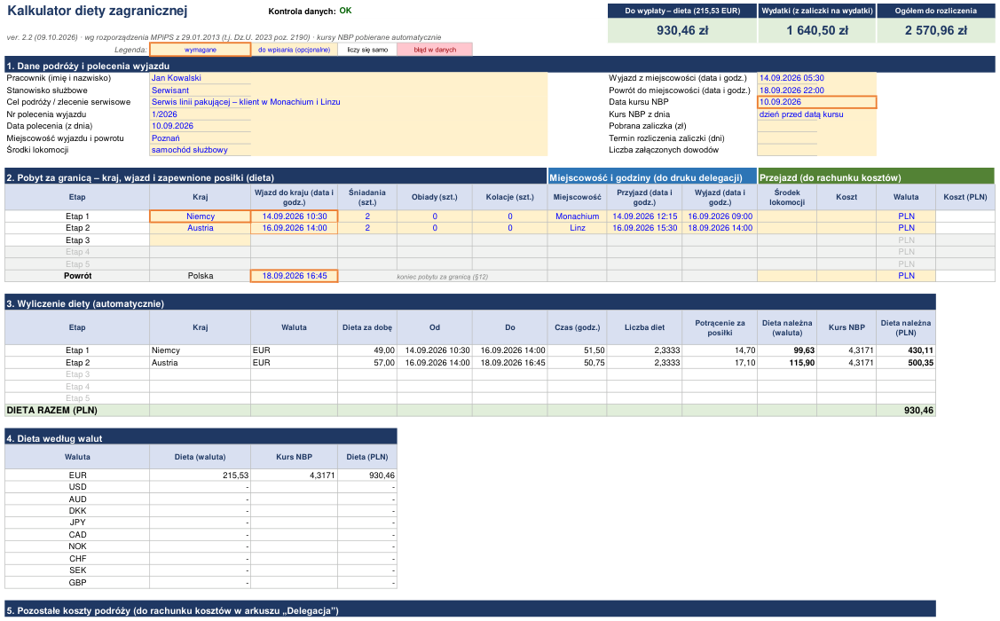
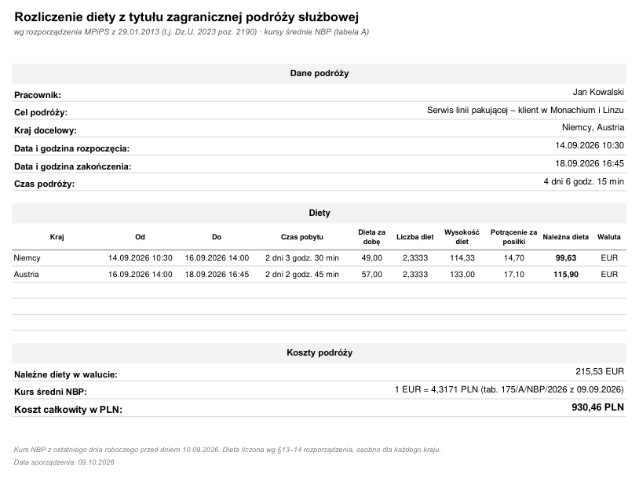
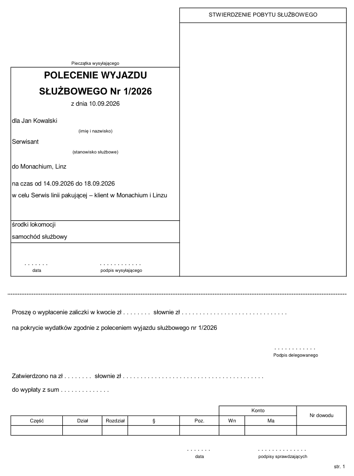
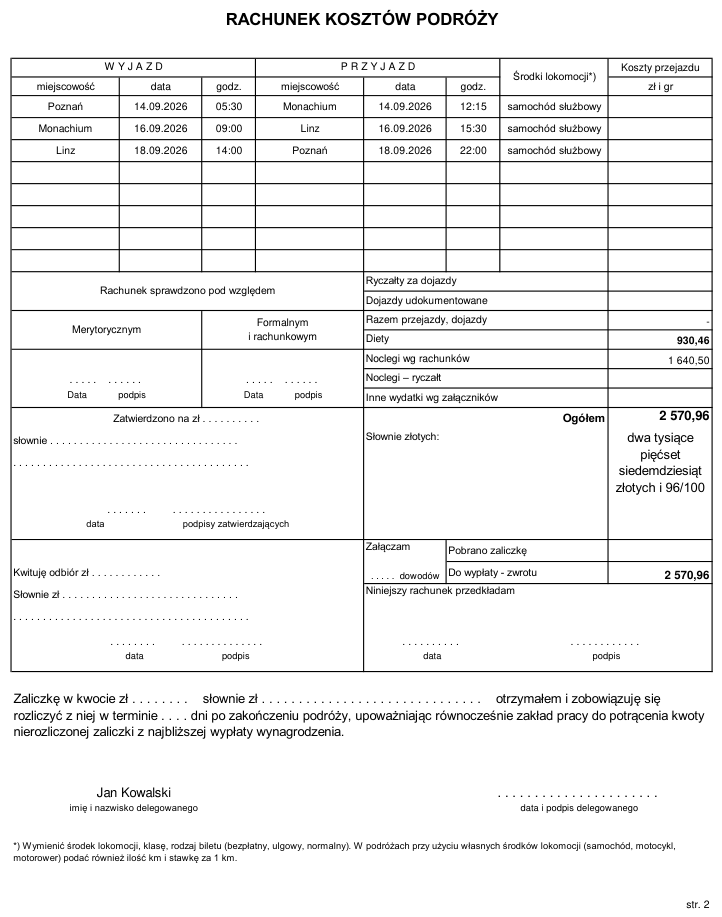

# Kalkulator diety zagranicznej (Excel)

Kalkulator diety z tytułu zagranicznej podróży służbowej. Działa w Excelu i automatycznie wypełnia druk delegacji („Polecenie wyjazdu służbowego” + „Rachunek kosztów podróży”). Powstał dla serwisantów wyjeżdżających za granicę.

- **Bez makr.** Wszystko liczą formuły, plik `.xlsx` można otworzyć bez włączania VBA.
- **Kursy NBP pobierane automatycznie** z `api.nbp.pl`: średni kurs z tabeli A z dnia poprzedzającego datę kursu albo z tego dnia. Przy dniu wolnym brany jest ostatni wcześniejszy kurs.
- **Waluta i stawka diety wynikają z kraju.** Dane obejmują 120 państw z załącznika do rozporządzenia.
- **Do 5 krajów w jednej podróży**, dla każdego dieta liczona osobno, z potrąceniami za zapewnione posiłki.
- **Druk delegacji i raport** gotowe do wydruku na A4.

## ⬇️ Pobierz

**[Pobierz Kalkulator_delegacji_zagranicznej.xlsx](https://github.com/krystianr84/delegacji_zagranicznej_plus/releases/latest/download/Kalkulator_delegacji_zagranicznej.xlsx)** – najnowsza wersja, jeden plik, bez instalacji.

Plik zawiera przykładowe, fikcyjne dane („Jan Kowalski”, Niemcy + Austria), żeby od razu było widać, jak działa. Nadpisz je własnymi. Starsze wersje i opis zmian: [Wydania](https://github.com/krystianr84/delegacji_zagranicznej_plus/releases) i [historia zmian](CHANGELOG.md).

## Zrzuty ekranu

**Kalkulator** – dane wpisuje się w żółte pola, resztę liczą formuły:

| Raport | Delegacja – str. 1 | Delegacja – str. 2 |
|---|---|---|
|  |  |  |

## Wymagania

- **Excel z Microsoft 365 lub Excel 2024 na Windows.** Na Macu, w Excelu w przeglądarce, w LibreOffice i w Arkuszach Google kursy się nie pobiorą (szczegóły w sekcji [Problemy i rozwiązania](#problemy-i-rozwiązania)).
- **Dostęp do internetu** (api.nbp.pl) przy otwieraniu i przeliczaniu pliku.

## Jak używać

1. Otwórz plik. Plik pobrany z internetu otwiera się w **Widoku chronionym**. Kliknij **Włącz edytowanie**, a jeśli Excel zapyta, także **Włącz zawartość**. Bez tego kursy NBP się nie pobiorą.
2. W arkuszu **Kalkulator** wypełnij żółte pola (pomarańczowa ramka = pole wymagane):
   - **sekcja 1** – pracownik, cel, nr i data polecenia, wyjazd i powrót do miejscowości, data kursu NBP;
   - **sekcja 2** – kolejne kraje z chwilą przekroczenia granicy (samolot: start z ostatniego lotniska w kraju), liczbą zapewnionych posiłków, miejscowością i kosztami przejazdu. W wierszu **Powrót** wpisz przekroczenie granicy PL w drodze powrotnej (samolot: lądowanie);
   - **sekcja 5** – ryczałty, noclegi i inne wydatki (kwoty w walutach obcych przeliczają się po kursie NBP).
3. **Kontrola danych** u góry arkusza pokazuje `OK` albo opis błędu, a pole z błędem podświetla się na czerwono. Kafelki pokazują dietę do wypłaty, wydatki i kwotę ogółem do rozliczenia.
4. Drukuj arkusz **Raport** (1 strona) albo **Delegacja** (2 strony): `Ctrl+P` albo *Plik → Eksportuj → PDF*.

Więcej wskazówek jest w arkuszu **Instrukcja** w pliku.

## Problemy i rozwiązania

**Kontrola pokazuje „Brak kursu NBP” albo kursy są puste**
1. Sprawdź, czy kliknięto **Włącz edytowanie** (żółty pasek Widoku chronionego) i **Włącz zawartość**, jeśli Excel o to pytał.
2. Naciśnij `Ctrl+Alt+F9` – wymusza ponowne przeliczenie i pobranie kursów.
3. Sprawdź **datę kursu**. Kurs z przyszłej daty jeszcze nie istnieje – NBP publikuje kursy w dni robocze, około południa.
4. Otwórz w przeglądarce <https://api.nbp.pl/api/exchangerates/tables/a/>. Jeśli strona się nie otwiera, a internet działa, sieć firmowa (proxy, zapora) blokuje NBP. Poproś dział IT o dostęp do `api.nbp.pl` albo skorzystaj z kalkulatora poza siecią firmową.

**W komórkach widać `#NAZWA?`**
Excel jest za stary. Plik używa nowych funkcji (`LAMBDA`, `TEXTAFTER`, `TEXTSPLIT` i innych), których nie ma w Excelu 2021 i starszych. Potrzebny jest Excel z Microsoft 365 albo Excel 2024 na Windows.

**Używam Maca, Excela w przeglądarce, LibreOffice albo Arkuszy Google**
Te programy nie obsługują funkcji `WEBSERVICE`, więc kursy NBP się nie pobiorą, a dieta w PLN się nie policzy. Plik trzeba otworzyć w Excelu na Windows.

**Nie mogę nic wpisać w komórkę**
Arkusze są chronione, żeby przypadkiem nie skasować formuły. Wpisywać można tylko w żółte pola. Ochrona jest **bez hasła** – w razie potrzeby wyłączysz ją przez *Recenzja → Nie chroń arkusza*.

**Excel nie przyjmuje daty**
Wpisz datę i godzinę w formacie `14.09.2026 10:30`. Tekst, którego Excel nie rozpoznał jako daty, kontrola oznacza jako „Niepoprawna data” i podświetla pole na czerwono.

**Kafelki wyniku pokazują „—”**
Kontrola danych nie jest `OK`. Przeczytaj komunikat u góry arkusza i popraw pole podświetlone na czerwono. Najczęstsze przyczyny: brak daty wjazdu albo powrotu, pusty etap między krajami, etapy nie po kolei, więcej posiłków niż dni pobytu w kraju.

**Jak wpisać podróż samolotem?**
Jako wjazd do kraju wpisz godzinę **startu** samolotu z ostatniego lotniska w Polsce, a jako powrót – godzinę **lądowania** na pierwszym lotnisku w Polsce (§12 rozporządzenia).

**Byłem w kilku krajach**
Każdy kraj to osobny etap (wiersz w sekcji 2), wpisany w kolejności podróży. Etap trwa od wjazdu do danego kraju do wjazdu do następnego, a ostatni – do powrotu przez granicę PL. Nie zostawiaj pustych wierszy między krajami.

**Co wpisać w posiłkach?**
Liczbę śniadań, obiadów i kolacji **zapewnionych** w danym kraju (np. śniadania w cenie hotelu, obiady u klienta). Każdy posiłek pomniejsza dietę o 15% (śniadanie) albo 30% (obiad, kolacja) stawki dziennej.

**Jak usunąć przykładowe dane?**
Kliknij żółte pole i naciśnij `Delete` (kilka pól naraz zaznaczysz z `Ctrl`). Jeśli zaznaczenie obejmie też zablokowaną komórkę, Excel odmówi – wtedy zaznacz same żółte pola. Formuł nie skasujesz, bo są chronione.

**Kalkulator nie liczy diety krajowej, kilometrówki ani ryczałtów**
Tak, to celowe. Liczona jest tylko dieta zagraniczna. Pozostałe koszty wpisuje się gotowymi kwotami w sekcji 5 – trafiają na druk delegacji i do kwoty ogółem.

## Zasady obliczeń

Rozporządzenie MPiPS z 29.01.2013 w sprawie należności przysługujących pracownikowi z tytułu podróży służbowej (t.j. Dz.U. 2023 poz. 2190), stawki obowiązujące od 29.11.2022:

| Przepis | Reguła |
|---|---|
| §12 – czas | Od przekroczenia granicy w drodze za granicę do przekroczenia jej w drodze powrotnej (samolot: start – lądowanie). Etap kończy się wjazdem do kolejnego kraju. |
| §13 – dieta | Za każdą pełną dobę 100%; niepełna doba: do 8 h – 1/3, ponad 8 do 12 h – 1/2, ponad 12 h – 100%. Liczona osobno dla każdego kraju. |
| §14 – posiłki | Śniadanie −15%, obiad −30%, kolacja −30% diety dziennej. Dieta nie spada poniżej zera. |
| §20 – kurs | Średni kurs NBP (tabela A) z dnia poprzedzającego datę kursu albo z dnia daty kursu (do wyboru). Przy dniu wolnym – ostatni wcześniejszy kurs. |

**Przypadek kontrolny**: Węgry, 28.09.2026 12:00 → 02.10.2026 16:00, bez posiłków, kurs z 08.10.2026 → **4 dni 4 godz. 0 min, 190,67 EUR, 834,92 PLN** (kurs 4,3789, tabela 196/A/NBP/2026).

**Aktualność stawek:** stawki diet są w arkuszu **Kraje**. Po zmianie przepisów można je tam poprawić (po wyłączeniu ochrony arkusza) albo pobrać nową wersję kalkulatora. W 2026 r. był projekt podwyżki stawek – sprawdź, czy weszła w życie.

## Dla programistów

Plik `.xlsx` jest generowany ze skryptów w `build/` (Python + Excel przez COM). Budowanie, testy, struktura repozytorium i wydawanie nowych wersji: [`docs/BUDOWANIE.md`](docs/BUDOWANIE.md).

## Zastrzeżenie

Narzędzie pomocnicze, bez gwarancji poprawności wyliczeń. Przed wypłatą sprawdź wynik z obowiązującymi przepisami i regulaminem podróży w Twojej firmie. Projekt nie jest powiązany z NBP.

## Licencja

Kalkulator (plik `.xlsx`, skrypty w `build/` i dokumentacja) jest udostępniony na licencji **MIT** – zobacz [`LICENSE`](LICENSE). Możesz go używać, kopiować, zmieniać i rozpowszechniać, także w firmie i komercyjnie, pod warunkiem zachowania informacji o autorze i treści licencji. Oprogramowanie jest dostarczane „tak jak jest”, bez żadnej gwarancji.

Stawki diet pochodzą z rozporządzenia (akt prawny – nie podlega prawu autorskiemu).
